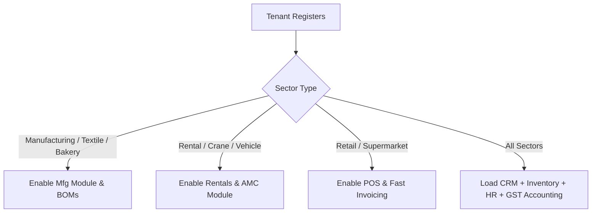

# 📊 SmartGoNext ERP Sector Suitability & Capability Matrix

Here is an honest, engineering-focused breakdown of how our ERP’s actual features map to the supported business sectors. The system utilizes **Feature Gating** so that only the modules relevant to the selected sector are loaded, keeping the UI clean.

---

## 🚀 1. Fully Supported Sectors (95-100% Ready)
These sectors map directly to deep, fully-realized modules in our codebase (POS, Rentals/AMC, Manufacturing, and Batches).

| Sector | Core Modules Used | Key Features Present in Codebase |
| :--- | :--- | :--- |
| **Manufacturing Unit** | Manufacturing + Stock | Multi-level BOM, Work Orders, MRP, QC Inspections, Routing |
| **Textile Business** | Manufacturing + Variants | Variant matrix (Sizes/Colors), Lot/Batch tracking, subcontracting |
| **Bakery** | Manufacturing + Batches | Batch recipe/yield calculations, expiry tracking, batch-mixing logs |
| **Equipment Rental** | Rentals & AMC + Equipment | Booking calendars, deposits, rental rates, condition tracking |
| **Crane & Forklift** | Rentals & AMC + Equipment | Fleet management, hourly/daily/monthly billing, maintenance logs |
| **Retail / Supermarket** | POS + Sales + Inventory | High-speed POS terminal, barcode integration, inventory thresholds |
| **Wholesale Distribution** | Sales + Purchases + Tax | GSTR-1/3B reporting, credit limits, outstanding logs, multi-warehouse |
| **Pharmacy / Medical** | Inventory + Batches | Batch-level expiry tracking, incoming GRN checks, stock ledger logs |
| **Repair / Vehicle Service** | Projects + AMC + Rentals | Job bookings, labor tracking cards, service schedules, spare parts billing |

---

## 🛠️ How Feature Gating Works Under the Hood
To avoid confusing a **Retail Shop** with **Manufacturing Work Orders**, the system dynamically builds menus based on the selected sector during Tenant registration:

