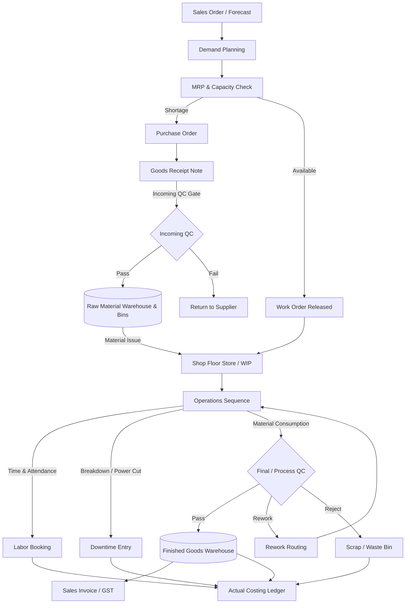

# 🇮🇳 Indian Manufacturing Module Upgrades & Real-World Integration Plan

To adapt the **Universal Manufacturing Engine** to the realities of Indian and Tamil Nadu factories, the system must shift from an idealized, linear flow to an **adaptive, actual-data-driven execution loop**.

---

## 🏗️ 1. Real-World Manufacturing Flow Diagram

This diagram visualizes how the workflow branches, loops for QC Rework, handles downtime/power cuts, and tracks raw material batch origins.



---

## 🗄️ 2. Database Schema Updates

Below is the database migration schema to support multi-UOM conversions, batch lineage, rework routing, downtime, and actual costing.

### 2.1 Multi-UOM Conversion Engine
```sql
CREATE TABLE material_uom_conversions (
    id INT AUTO_INCREMENT PRIMARY KEY,
    tenant_id INT NOT NULL,
    item_id INT NOT NULL, -- Link to Product
    from_uom VARCHAR(20) NOT NULL, -- e.g., 'Drum', 'Box'
    to_uom VARCHAR(20) NOT NULL, -- e.g., 'Liters', 'Pieces'
    conversion_factor DECIMAL(12, 6) NOT NULL, -- e.g., 200.000000 (1 Drum = 200 Liters)
    is_active BOOLEAN DEFAULT TRUE,
    created_at TIMESTAMP DEFAULT CURRENT_TIMESTAMP,
    FOREIGN KEY (item_id) REFERENCES products(id)
);
```

### 2.2 Goods Receipt Note (GRN) & Incoming QC
```sql
CREATE TABLE goods_receipt_notes (
    id INT AUTO_INCREMENT PRIMARY KEY,
    tenant_id INT NOT NULL,
    supplier_id INT NOT NULL,
    purchase_order_id INT NULL,
    grn_number VARCHAR(50) UNIQUE NOT NULL, -- e.g., GRN-2026-00001
    invoice_no VARCHAR(50) NULL,
    vehicle_no VARCHAR(20) NULL, -- e.g., TN-37-AB-1234
    lr_no VARCHAR(50) NULL, -- Lorry Receipt
    received_date DATETIME NOT NULL,
    gate_entry_no VARCHAR(30) NULL,
    status VARCHAR(20) DEFAULT 'pending_qc', -- pending_qc, approved, rejected, partial
    created_at TIMESTAMP DEFAULT CURRENT_TIMESTAMP
);

CREATE TABLE grn_items (
    id INT AUTO_INCREMENT PRIMARY KEY,
    grn_id INT NOT NULL,
    item_id INT NOT NULL,
    po_qty DECIMAL(12, 4) NOT NULL,
    received_qty DECIMAL(12, 4) NOT NULL,
    accepted_qty DECIMAL(12, 4) DEFAULT 0.00,
    rejected_qty DECIMAL(12, 4) DEFAULT 0.00,
    batch_no VARCHAR(50) NULL, -- Raw material batch identifier
    mfg_date DATE NULL,
    expiry_date DATE NULL,
    FOREIGN KEY (grn_id) REFERENCES goods_receipt_notes(id),
    FOREIGN KEY (item_id) REFERENCES products(id)
);
```

### 2.3 Batch Traceability & Lineage Map
```sql
CREATE TABLE batch_lineage (
    id INT AUTO_INCREMENT PRIMARY KEY,
    tenant_id INT NOT NULL,
    work_order_id INT NOT NULL,
    finished_item_id INT NOT NULL,
    finished_batch_no VARCHAR(50) NOT NULL, -- Finished Lot
    material_item_id INT NOT NULL,
    material_batch_no VARCHAR(50) NOT NULL, -- Raw Lot consumed
    qty_consumed DECIMAL(12, 4) NOT NULL,
    FOREIGN KEY (work_order_id) REFERENCES work_orders(id)
);
```

### 2.4 Actual Material Consumption & Returns
```sql
-- Modify existing production_material_issues table:
ALTER TABLE production_material_issues 
ADD COLUMN qty_planned DECIMAL(12, 4) NOT NULL,
ADD COLUMN qty_consumed DECIMAL(12, 4) DEFAULT 0.00,
ADD COLUMN qty_returned DECIMAL(12, 4) DEFAULT 0.00,
ADD COLUMN variance DECIMAL(12, 4) GENERATED ALWAYS AS (qty_consumed - qty_planned) STORED;
```

### 2.5 Machine Downtime Entries (Power Cuts, Breakdown)
```sql
CREATE TABLE machine_downtimes (
    id INT AUTO_INCREMENT PRIMARY KEY,
    tenant_id INT NOT NULL,
    machine_id INT NOT NULL,
    work_order_id INT NULL,
    start_time DATETIME NOT NULL,
    end_time DATETIME NULL,
    downtime_type VARCHAR(30) NOT NULL, -- 'breakdown', 'power_failure', 'planned_maintenance'
    reason TEXT NULL, -- e.g., 'TNEB Grid Outage', 'Hydraulic line rupture'
    operator_id INT NULL,
    production_impact VARCHAR(20) DEFAULT 'stop', -- stop, reduced_capacity
    created_at TIMESTAMP DEFAULT CURRENT_TIMESTAMP,
    FOREIGN KEY (machine_id) REFERENCES machines(id)
);
```

### 2.6 Labor Time Booking
```sql
CREATE TABLE labor_time_bookings (
    id INT AUTO_INCREMENT PRIMARY KEY,
    tenant_id INT NOT NULL,
    employee_id INT NOT NULL,
    work_order_id INT NOT NULL,
    operation_id INT NOT NULL,
    start_time DATETIME NOT NULL,
    end_time DATETIME NULL,
    hours_worked DECIMAL(6, 2) GENERATED ALWAYS AS (TIMESTAMPDIFF(MINUTE, start_time, end_time) / 60.0) STORED,
    activity_type VARCHAR(30) DEFAULT 'production', -- production, setup, idle, cleaning
    FOREIGN KEY (work_order_id) REFERENCES work_orders(id)
);
```

---

## ⚙️ 3. Implementation Phases & Milestones

> [!IMPORTANT]
> The upgrades are ranked below based on operational importance for the Indian manufacturing workspace.

| Phase | Milestone | Priority | Goal |
| :--- | :--- | :--- | :--- |
| **Phase 1** | **Procurement & Inventory Audit (GRN + UOM + Traceability)** | 🔴 Critical | Implement Multi-UOM conversion, raw material Batch receipt, Gate Entry, and Lorry tracking inside GRN. |
| **Phase 2** | **Material Consumption & Returns (WIP Variance)** | 🔴 Critical | Transition from auto-deduction to actual consumption entry. Support excess returns and yield calculations. |
| **Phase 3** | **Shop Floor Execution & QC (Rework + Bins)** | 🔴 Critical | Add QC PASS/REWORK/REJECT pathways, multi-warehouse zones/bins, and in-process sample checks. |
| **Phase 4** | **Resource Downtime & Labor (OEE + Timecards)** | 🟠 High | Implement machine breakdowns, TNEB power failure logs, and employee operation time cards. |
| **Phase 5** | **BOM Versioning & Actual Costing Variance** | 🟠 High | Lock BOM revisions at Release. Calculate Actual vs Standard cost variances post-production. |

---

## 🚀 Next Steps & Feedback
We will proceed to implement **Phase 1 (Multi-UOM Engine and GRN with Gate Entry)**. 

Please review this plan and let us know if there are specific local taxation or workflow requirements you would like to adjust.
