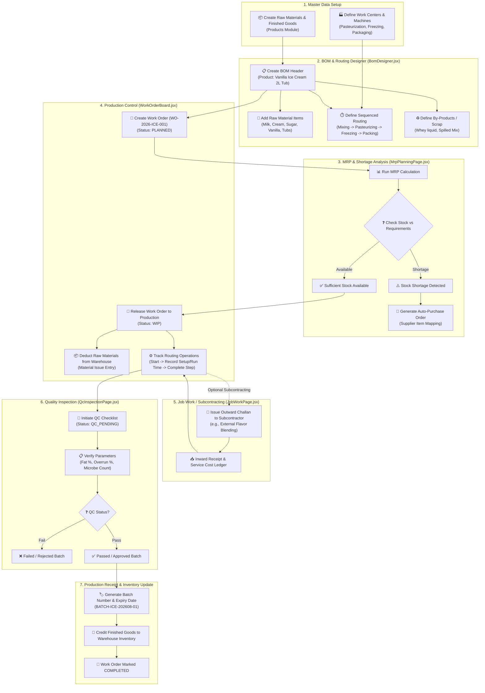

# 🍦 Universal Manufacturing Engine: Complete End-to-End Workflow & Architecture Guide

This document provides an exhaustive, step-by-step ("inch-by-inch") breakdown of how the **Universal Manufacturing Engine** operates across the entire ERP system. It covers data flow, backend REST APIs, database state mutations, and user interactions across all React frontend pages, using a real-world **Process Manufacturing Example: Industrial Vanilla Ice Cream Production (2L Tubs)**.

---

## 📐 1. Master System Workflow Diagram

Below is the complete architectural flowchart detailing the movement of data, materials, quality gates, and financial ledgers from initial BOM definition to final warehouse stock receipt.



---

## 🛠️ 2. Detailed Step-by-Step ("Inch-by-Inch") Industrial Execution Walkthrough

### Example Case: Manufacturing **1,000 Tubs of Premium Vanilla Ice Cream (2L)**

---

### Step 1: Master Data Preparation
Before starting production, all items and machinery must exist in the database.

1. **Raw Material Items Created** (`/api/v1/products`):
   - **Raw Milk** (SKU: `RM-MILK-L`, UOM: Liters, Cost: ₹45/L)
   - **Dairy Cream 40%** (SKU: `RM-CREAM-KG`, UOM: Kg, Cost: ₹220/Kg)
   - **Refined Sugar** (SKU: `RM-SUGAR-KG`, UOM: Kg, Cost: ₹40/Kg)
   - **Natural Vanilla Extract** (SKU: `RM-VANILLA-L`, UOM: Liters, Cost: ₹1,500/L)
   - **2L Plastic Tubs & Lids** (SKU: `PM-TUB-2L`, UOM: Pcs, Cost: ₹12/Pcs)
2. **Finished Good Item Created**:
   - **Vanilla Ice Cream 2L Tub** (SKU: `FG-ICE-VAN-2L`, UOM: Pcs, Sale Price: ₹350)
3. **Work Centers & Machines Created** (`/api/v1/manufacturing/work-centers`, `/api/v1/manufacturing/machines`):
   - **Work Center 1: Processing Plant** (Labor: ₹300/hr, Machine Rate: ₹500/hr)
     - Machine: *Homogenizer & Pasteurizer Unit*
   - **Work Center 2: Freezing & Aging Line** (Labor: ₹250/hr, Machine Rate: ₹600/hr)
     - Machine: *Continuous Ice Cream Freezer*
   - **Work Center 3: Automatic Packaging Line** (Labor: ₹200/hr, Machine Rate: ₹300/hr)
     - Machine: *Tub Filling & Sealing Jig*

---

### Step 2: Designing the Bill of Materials (BOM) & Routing
**Page**: `frontend/src/pages/manufacturing/BomDesigner.jsx`

#### 2.1 BOM Header Setup
- **Product Selected**: `Vanilla Ice Cream 2L Tub`
- **BOM Name**: `Standard Commercial Batch Recipe V1`
- **Version**: `V1.0`
- **Standard Cost**: ₹145,000.00 per 1,000 Tubs (₹145/Tub)
- **Overhead Cost**: ₹15,000.00 (Electricity, Refrigeration, Steam)

#### 2.2 Components & Recipe Ratios (Per 1,000 Tubs / 2,000 Liters)
| Item | SKU | Required Qty | UOM | Scrap/Waste % |
| :--- | :--- | :--- | :--- | :--- |
| **Raw Milk** | `RM-MILK-L` | 1,200.00 | Liters | 2.0% |
| **Dairy Cream** | `RM-CREAM-KG` | 350.00 | Kg | 1.5% |
| **Refined Sugar** | `RM-SUGAR-KG` | 220.00 | Kg | 1.0% |
| **Vanilla Extract**| `RM-VANILLA-L` | 15.00 | Liters | 0.5% |
| **2L Plastic Tubs**| `PM-TUB-2L` | 1,020.00 | Pcs | 2.0% |

#### 2.3 Sequenced Routing Operations
1. **Op #10: Batch Mixing & Pasteurization**
   - *Work Center*: Processing Plant | *Machine*: Homogenizer & Pasteurizer
   - *Setup Time*: 30 mins | *Run Time*: 45 mins per batch
2. **Op #20: Aging & Churn-Freezing**
   - *Work Center*: Freezing & Aging Line | *Machine*: Continuous Ice Cream Freezer
   - *Setup Time*: 15 mins | *Run Time*: 60 mins per batch
3. **Op #30: Tub Filling, Sealing & Deep Freeze Staging**
   - *Work Center*: Packaging Line | *Machine*: Tub Filling & Sealing Jig
   - *Setup Time*: 15 mins | *Run Time*: 30 mins per batch

#### 2.4 By-products / Scrap
- **Skimmed Milk Residue**: 50 Liters (Co-product / Salable)

> **API Payload Dispatched**: `POST /api/v1/manufacturing/boms`

---

### Step 3: Production Work Order Creation & MRP Calculation
**Pages**: `WorkOrderBoard.jsx` & `MrpPlanningPage.jsx`

1. **Creating the Work Order**:
   - The Production Manager opens `WorkOrderBoard.jsx` and clicks **+ New Work Order**.
   - Selects **Vanilla Ice Cream 2L Tub (BOM V1.0)**.
   - Sets **Planned Quantity**: `1,000 Tubs`.
   - Work order generated: `WO-2026-ICE-001` (Status: `PLANNED`).
2. **Running Material Requirements Planning (MRP)**:
   - The user opens `MrpPlanningPage.jsx` and clicks **Run MRP Calculation**.
   - The engine checks warehouse stock levels:
     - Milk in Stock: 1,500 L (Required: 1,200 L) ➔ **Sufficient**
     - Cream in Stock: 100 Kg (Required: 350 Kg) ➔ ⚠️ **Shortage of 250 Kg**
   - The system displays the shortage row and enables the **Generate Purchase Order** button linked to preferred supplier *Apex Dairy Farmers Ltd*.
   - Clicking **Generate PO** dispatches `POST /api/v1/manufacturing/mrp/generate-po`, automatically creating a draft Purchase Order for 250 Kg of Dairy Cream.

---

### Step 4: Releasing to Production & Floor Execution
**Page**: `WorkOrderBoard.jsx`

1. **Releasing the Work Order**:
   - Once raw materials arrive, the user clicks **Release** on `WO-2026-ICE-001`.
   - Status changes from `PLANNED` to `WIP / RELEASED`.
   - Backend automatically generates a `ProductionMaterialIssue` entry, deducting raw materials from the main warehouse to prevent double-allocation.
2. **Tracking Floor Routing Operations**:
   - The floor supervisor clicks **Track Ops** on card `WO-2026-ICE-001`.
   - **Step 10 (Pasteurization)**: Clicks **Start** ➔ Status: `IN_PROGRESS`. After completion, inputs actual setup time (30 mins) and run time (42 mins), then clicks **Complete**.
   - **Step 20 (Freezing)**: Starts and completes aging/freezing.
   - **Step 30 (Packaging)**: Starts and completes filling 1,000 tubs.

---

### Step 5: Subcontracting & Job Work (Optional Step)
**Page**: `frontend/src/pages/manufacturing/JobWorkPage.jsx`

If special flavor pastes (e.g., custom roasted vanilla bean syrup) are prepared by an external specialist vendor:
1. Production Supervisor clicks **+ New Job Work Order**.
2. Selects Vendor: *Gourmet Flavor Extracts Pvt Ltd*.
3. Generates Outward Challan: `JW-CH-2026-089`.
4. Attaches materials sent: 15L Vanilla Extract Base.
5. Records agreed Service Cost: ₹4,500.
6. When the processed syrup returns, the user clicks **Receive**, updating the Job Work status to `COMPLETED` and logging the vendor invoice expense.

---

### Step 6: Quality Control (QC Inspection)
**Page**: `frontend/src/pages/manufacturing/QcInspectionPage.jsx`

Once production finishes, the batch enters `QC_PENDING` status.

1. Quality Inspector opens `QcInspectionPage.jsx` and clicks **+ New Inspection**.
2. Selects Reference: `Work Order WO-2026-ICE-001`.
3. Inputs Quantities: `Passed Qty: 995`, `Failed Qty: 5` (Damaged lids/tubs).
4. Fills out the custom Quality Parameter Checklist:
   - **Fat Percentage**: Standard `10.0% - 12.0%` | Actual `11.4%` ➔ **PASS**
   - **Overrun (Air Volume)**: Standard `80% - 85%` | Actual `82%` ➔ **PASS**
   - **Microbiological Count**: Standard `< 10 CFU/g` | Actual `0 CFU/g` ➔ **PASS**
5. Selects QC Status: `PASSED` and saves.
6. Backend updates Work Order status to `QC_PASSED`.

---

### Step 7: Final Production Receipt & Warehouse Stocking
**Page**: `WorkOrderBoard.jsx`

1. User clicks **Receipt** on `WO-2026-ICE-001`.
2. Modal prompts for batch details:
   - **Produced Qty**: `995 Tubs`
   - **Batch Number**: `BATCH-ICE-202608-01`
   - **Expiry Date**: `2027-02-14` (6 months shelf life)
   - **Destination Warehouse**: `Main Cold Storage Warehouse - Bangalore`
3. Clicking **Receive** executes the transaction:
   - Stock of `Vanilla Ice Cream 2L Tub` increases by `995 Pcs` with batch lot `BATCH-ICE-202608-01`.
   - Work Order `WO-2026-ICE-001` transitions to `COMPLETED` status.
   - Cost accounting updates total inventory valuation by adding standard manufacturing & labor cost.

---

## 💻 3. Complete Frontend React Module Map & URL Blueprint

Below is the complete Blueprint Map of exact browser URLs (`http://localhost:3000/...` or `http://localhost:3001/...`) to navigate through every single phase of the manufacturing process:

```
[Phase 1: Products & Stock] ──> http://localhost:3000/products
            │
            ▼
[Phase 2: BOM & Routing]    ──> http://localhost:3000/manufacturing/bom
            │
            ▼
[Phase 3: MRP & Shortages]  ──> http://localhost:3000/manufacturing/mrp
            │                               │
            │ (Auto PO)                     ▼
            └───────────────────────> http://localhost:3000/purchases
            │
            ▼
[Phase 4: Production Board] ──> http://localhost:3000/manufacturing/work-orders
            │                               │
            │ (Subcontracting)              ▼
            └───────────────────────> http://localhost:3000/manufacturing/job-work
            │
            ▼
[Phase 5: Quality Control]  ──> http://localhost:3000/manufacturing/qc
            │
            ▼
[Phase 6: Warehouse Stock]  ──> http://localhost:3000/inventory
```

| Step # | Phase Name | Direct URL | React Component | Main Action |
| :--- | :--- | :--- | :--- | :--- |
| **1** | **Product & Raw Material Setup** | `http://localhost:3000/products` | `ProductsPage.jsx` | Add Raw Materials & Finished Goods |
| **2** | **BOM & Routing Designer** | `http://localhost:3000/manufacturing/bom` | `BomDesigner.jsx` | Define multi-level recipe ratios & machine routings |
| **3** | **MRP & Shortage Analysis** | `http://localhost:3000/manufacturing/mrp` | `MrpPlanningPage.jsx` | Calculate raw material shortages & auto-generate POs |
| **3b** | **Purchase Orders (Raw Materials)** | `http://localhost:3000/purchases` | `PurchasesPage.jsx` | Receive incoming supplier shipments |
| **4** | **Work Order Production Board** | `http://localhost:3000/manufacturing/work-orders` | `WorkOrderBoard.jsx` | Release WO, track WIP routing steps, submit receipt |
| **5** | **Job Work & Subcontracting** | `http://localhost:3000/manufacturing/job-work` | `JobWorkPage.jsx` | Send materials to external vendors via outward challan |
| **6** | **Quality Control & Testing** | `http://localhost:3000/manufacturing/qc` | `QcInspectionPage.jsx` | Record quality parameter checklists (Pass/Fail) |
| **7** | **Finished Goods Inventory** | `http://localhost:3000/inventory` | `InventoryPage.jsx` | View final batch stock in warehouse lot inventory |

---

## 📌 Summary
This end-to-end workflow guarantees full traceability, precise stock accounting, zero orphan data entries, and seamless multi-tenant operations across all discrete and process manufacturing industries.

